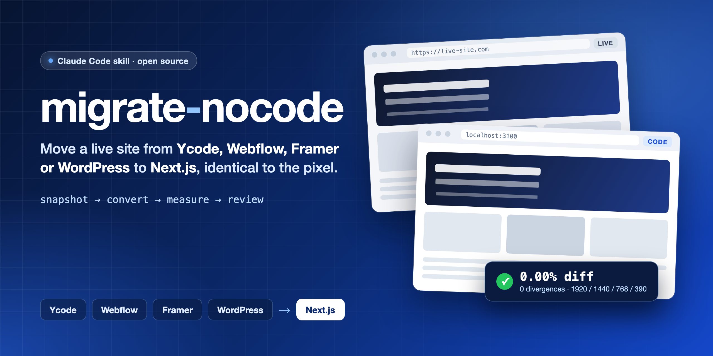
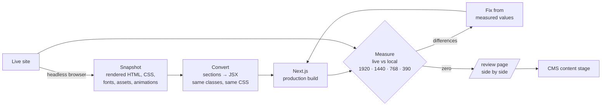

<p align="center">
  <a href="README.md"></a>
  <a href="README.pt-BR.md"></a>
</p>

<p align="center">
  
</p>

<p align="center">
  <a href="#install"></a>
  <a href="#starter-prompt"></a>
</p>

<p align="center">
  
  
  
  
  
</p>

# migrate-nocode

**A Claude Code plugin that migrates a live website built on Ycode, Webflow, Framer or WordPress to a Next.js
codebase that looks identical to the live site — and proves it with measurements, page by page, at four widths.**

Most "rebuild this site in code" attempts end up *similar*. Spacing drifts, fonts break lines in different places,
animations feel off, mobile is improvised. This plugin takes the opposite approach: it treats the live site as the
spec, converts its rendered HTML instead of reinterpreting it, and runs a measurement loop in a headless browser
until the difference between the live site and the new code is **zero**.

It was born from real client migrations (a 107-route bilingual Ycode site ended with **424 measurements at 0
divergent properties**) and packages everything those projects taught: the tools, the traps that cost hours, the
review page clients loved, and the CMS stage that comes after.

---

## Contents

- [How it works](#how-it-works)
- [What's inside](#whats-inside)
- [Install](#install)
- [Starter prompt](#starter-prompt)
- [What happens after you press Enter](#what-happens-after-you-press-enter)
- [Platform support](#platform-support)
- [The review page](#the-review-page)
- [The CMS stage](#the-cms-stage)
- [Tools reference](#tools-reference)
- [Definition of done](#definition-of-done)
- [Safety](#safety)
- [FAQ](#faq)
- [Contributing](#contributing)

---

## How it works



**The principle: convert, don't interpret.** The live site already ships HTML with classes and CSS that produce
exactly what the client approved. So the plugin:

1. **Snapshots** every route in a real browser (rendered DOM *and* raw HTML, because animation data lives there),
   mirrors every asset with a stable local path, and records the date — live sites change during a migration.
2. **Converts** each section to JSX keeping every class, `data-*` and `aria-*` attribute, and every non-breaking space
   (yes, `U+00A0` changes line breaks).
3. **Measures** live vs local in Chromium at 1920, 1440, 768 and 390 px: computed styles of every text, image and
   control (paired by text, with vertical-offset discounting), section-by-section property diffs, full-page pixel
   diffs, document height, horizontal scroll, interaction states and animation timing.
4. **Fixes** only from measured values, never from "looks the same", until the report says zero.
5. **Shows** the result on a `/review` page — every page, current vs new, desktop and mobile, with the numbers.

Measurements freeze time on both sides (fake clock for GSAP/marquees/smooth scroll, frozen CSS animations), wait for
fonts and images to *really* load, mask randomized blocks and GIFs, and compare **rendered** colors. Without that, a
pixel diff is just noise.

> **Does it "use the web"?** Not web search. It drives a headless browser (Playwright/Chromium) against the live site
> you're migrating — that browser is the reference. It's read-only: GET requests at polite concurrency.

## What's inside

One plugin, seven skills that load only when needed:

| Skill | When it loads | What it brings |
|---|---|---|
| **`migrate`** | You ask to migrate a site | Intake questions, the phase-by-phase method, the tools, definition of done, final report |
| **`migrate-ycode`** | Site is on Ycode | Tailwind-native conversion, Ycode runtime (GSAP interactions, Swiper sliders) semantics, `.ycode` backup export |
| **`migrate-webflow`** | Site is on Webflow | `webflow.css` baseline then Tailwind, IX2 interaction extraction, `w-*` components, CMS via Data API v2 or CSV |
| **`migrate-framer`** | Site is on Framer | SSR CSS baseline then Tailwind, breakpoint variants, appear/scroll animations with Motion, CMS via CSV |
| **`migrate-wordpress`** | Site is on WordPress | Elementor / Divi / WPBakery / Gutenberg, jQuery plugins, content from folder, `.sql` dump or REST — ACF, JetEngine, CPT UI, Yoast, Rank Math |
| **`migrate-content`** | After the visual stage | Normalized content format, validation, import to Payload or files, redirects |
| **`migrate-review`** | End of every batch | Builds and opens the side-by-side `/review` page |

Plus 25+ Node scripts (snapshot, assets, tojsx, measure, sections, states, motion, texts, intent-check, verify-dom,
head-check, run-all, build-review, platform exporters) that get **copied into your project**, so the migration is
reproducible and committed with the code.

## Install

**Requirements:** [Claude Code](https://claude.com/claude-code) (CLI, desktop app or IDE extension), Node.js 20+,
~2 GB free disk for Chromium and mirrored assets.

### Option 1: Claude Code plugin (recommended)

Inside Claude Code:

```text
/plugin marketplace add JefersonMarcioEspindola/skill-migrate-nocode
/plugin install migrate-nocode@migrate-nocode
```

Restart Claude Code if it asks. The skills appear as `migrate-nocode:migrate`, `migrate-nocode:migrate-webflow`, etc.
Update later with `/plugin marketplace update migrate-nocode`.

### Option 2: skills CLI

```bash
npx skills add JefersonMarcioEspindola/skill-migrate-nocode
```

### Option 3: manual

```bash
git clone https://github.com/JefersonMarcioEspindola/skill-migrate-nocode.git
mkdir -p ~/.claude/skills
cp -R skill-migrate-nocode/plugins/migrate-nocode/skills/* ~/.claude/skills/
```

Keep the seven skill folders together: platform skills reference the shared scripts in `migrate/`.

The first run installs the browser itself (`npx playwright-core install chromium`).

## Starter prompt

Open Claude Code in an **empty folder** (or the repo you want the new site in) and paste:

```text
Use the migrate skill to migrate this site to Next.js, identical to the live version:

Live site: https://www.example.com
Figma (optional): <links or "none">
Backup / CMS export (optional): <path to .ycode, Webflow CSV/API token in .env.local, Framer CSV, WordPress folder or .sql dump, or "none yet">
Languages: <e.g. English only / EN + PT-BR under /pt-br>

Scope for now: visual only (layout, typography, images, motion, SEO, review page). CMS content comes later.
Ask me your intake questions in one message, then work autonomously until the board is done.
Do not deploy or push without asking me.
```

That's it. The `migrate` skill detects the platform, asks the rest in one message (git preferences, polish layer,
review password…) and gets to work. To resume after a usage limit: **"continue the board"**.

## What happens after you press Enter

| Phase | What the agent does | You get |
|---|---|---|
| 0. Setup | Scaffolds/opens the project, copies the tools, writes `migrate.config.json` | `tools/migrate/`, config |
| 1. Reconnaissance | Snapshots every route, mirrors assets, audits the live site's own bugs, reads the CMS structure from your backup or dump (inventory only, no content) | `snapshots/<date>/`, the board in `docs/layout-loop.md`, ONE question list |
| 2. Foundations | Fonts, base CSS, breakpoints, color variables, images, runtime libraries | Home measured; divergences drop from dozens to a few |
| 3. Shared components | Header variants, mobile menu, footer, forms | Measured in 3 widths and every state |
| 4. Pages | Up to 3 page agents in parallel, each owning its files | Every page at 0 divergences |
| 5. Motion | Every trigger, tween, easing, stagger, breakpoint | Motion sampled equal on both sides |
| 5b. CSS → Tailwind | Webflow, Framer and WordPress only: section by section, measured; a small documented `legacy.css` for what Tailwind can't express | Tailwind v4 codebase, same pixels |
| 6. Polish (optional) | Header contrast, hover lines, infinite marquee, brand 404, live bugs fixed | Recorded deviations |
| 7. SEO | Head per route, sitemap, hreflang, JSON-LD, redirects | `head-check` clean |
| 8. Review | Side-by-side page | `/review` |
| 9. Verification | Re-sync with live, independent verifier agents, code review, publish checklist | Zero measured divergences |
| 10. Report | Page × width table, exceptions, pending by owner, deploy checklist, client message | Report + `/review` opened |
| 11. CMS (later) | Export, normalize, validate, import to a dev database or files | Real, editable content, same pixels |

Everything is tracked in the project's `docs/` (board, changelog, pending list by owner, decision records), so the
work survives usage limits, context compaction and handoffs.

## Platform support

| | Ycode | Webflow | Framer | WordPress |
|---|---|---|---|---|
| CSS | Tailwind v4 classes as-is | `webflow.css` as baseline → Tailwind | SSR CSS as baseline → Tailwind | Theme + builder + plugin CSS as baseline → Tailwind |
| Stable ids for pairing | `data-layer-id` | `data-w-id` + DOM path | DOM path | Elementor `data-id` + DOM path |
| Animations | Interactions JSON from RSC payload → GSAP | IX2 JSON from `webflow.js` → keep or port | Appear data + sampled Motion | `data-settings`, Animate.css, AOS/WOW/GSAP |
| CMS source | `.ycode` backup | Data API v2 or CSV | CSV export | Folder, `.sql` dump or REST · ACF · JetEngine · CPT UI |
| Field-tested | ✅ full production migrations | Tools tested on public sites | Tools tested on public sites | Tools tested on public sites |

The method is platform-independent: anything a browser renders can be snapshotted and measured. Wix, Squarespace
or hand-made static sites work with the core `migrate` skill and generic rules. Webflow, Framer and WordPress have
had their tools run against real public sites; your first migration on each will still teach the skill something —
issues and PRs welcome.

## The review page

Clients don't read reports. They look at pictures. The `/review` page puts every page in sequence, one row each,
with four columns — **Desktop current · Desktop new · Mobile current · Mobile new** — and under each capture the
height, % of different pixels and number of divergences. It's `noindex`, blocked in robots, out of the sitemap, and
optionally behind Basic Auth (`REVIEW_PASSWORD`). The skill regenerates it after every batch and **opens it at the end
of every migration**.

## The CMS stage

Visual first, content second. During the visual stage, lists and posts are fixed JSON extracted from the snapshot,
rendered by one template per collection. The `migrate-content` skill then:

- exports from the platform (Ycode backup, Webflow Data API v2 / CSV, Framer CSV, WordPress folder / `.sql` / REST),
- understands custom fields (ACF groups, repeaters and flexible content, JetEngine meta boxes and relations, CPT UI
  post types, Yoast / Rank Math SEO),
- writes a **normalized format** (`content/<collection>.json` + assets + redirects + report) and validates it,
- imports with idempotent upserts into a **dev** database or into files — never production,
- swaps the mocks for real queries and re-measures: the content stage must not move a single pixel.

## Tools reference

| Script | Purpose |
|---|---|
| `detect.mjs <url>` | Guess the platform with evidence |
| `snapshot.mjs` | Rendered + raw HTML, facts (head, CSS, fonts, assets, animations) per route, dated |
| `assets.mjs [--verify]` | Mirror every asset to a stable local path; re-download what the CDN changed |
| `tojsx.mjs` | List sections and convert to TSX (classes, data-*, aria-*, NBSP, srcset, next/link) |
| `measure.mjs` | Live vs local: styles, pairing by text, offsets, height, scroll, pixel diff per band |
| `sections.mjs` | Section-by-section, ~45 computed properties per element |
| `states.mjs` | Hover, focus, click, step sequences, rest vs state on both sides |
| `motion.mjs` | Opacity/transform/visibility sampled over time on load and scroll |
| `texts.mjs` | Every visible text, alt and meta: live vs local and snapshot vs snapshot |
| `intent-check.mjs` | Bugs a pixel diff can't see: horizontal scroll, text under fixed header, clipped boxes, `href="#"`, cursors, resize |
| `verify-dom.mjs` | DOM of every template route vs the snapshot |
| `head-check.mjs` | `<head>` and status/redirects per route |
| `run-all.mjs` | Everything, all routes × widths, short summary |
| `build-review.mjs` | The `/review` page (`--measure --open`, `--static`) |
| Platform exporters | `ycode-export`, `webflow-cms-export`, `webflow-csv-import`, `framer-csv-import`, `wp-inventory`, `wp-export`, `content-validate` |

## Definition of done

Per page and width, against the production build: 0 element divergences and 0 divergent section properties; equal
document height (or a recorded exception); < ~0.3% differing pixels (image compression, GIFs and randomized blocks are
declared exceptions); texts, head and template DOM clean; no horizontal scroll; hover, focus, menu and animations
measured on both sides.

## Safety

- **Only migrate sites you own or are authorized to migrate.** The plugin reads public pages, read-only.
- Never reads, prints or commits `.env`, API tokens, `wp-config.php` credentials or backup secrets.
- No database writes in the visual stage; content imports go to a dev database after your OK.
- No deploy, push or `npm audit fix` without your explicit OK.
- Never invents content. Errors of the old site are replicated and reported for you to decide.

## FAQ

**How long does it take?** A 10–15 page site with a blog and case studies: a few hours of agent work for the visual
stage. Big sites burn a lot of usage; the skill caps parallel agents at 3 and checkpoints so you can resume.

**Do I need Figma?** No. The live site is the source of truth. Figma helps for desktop values, the favicon, the share
image and components the client redesigned but never published.

**Does it work in other agents (Cursor, Codex…)?** The skills are plain `SKILL.md` files plus Node scripts; agents that
support the skills format can use them. It's built and tested on Claude Code.

**Will the result be "clean code"?** It will be *faithful* code first: componentized per section, with the platform's classes (Ycode is already
Tailwind) or its CSS as a measured baseline. On Webflow, Framer and WordPress it is then converted to Tailwind section
by section, re-measured after each step, with a small documented `legacy.css` for what Tailwind can't express.
Refactoring into a design system is a separate, deliberate step: doing it before there is a measured baseline is
exactly what makes sites drift.

**What about forms, e-commerce, memberships?** Forms are migrated visually (all states) and wired to a backend in the
content stage. Shops and memberships are out of scope and get recorded as pending.

## Contributing

Issues and PRs are welcome, especially platform knowledge (a new builder, an animation format, a CMS export path) and
fixes to the tools. If you migrate a site with it, open an issue with what the skill got wrong: that's how the traps
list grew.

## License

[MIT](LICENSE) © Jeferson Marcio Espindola
