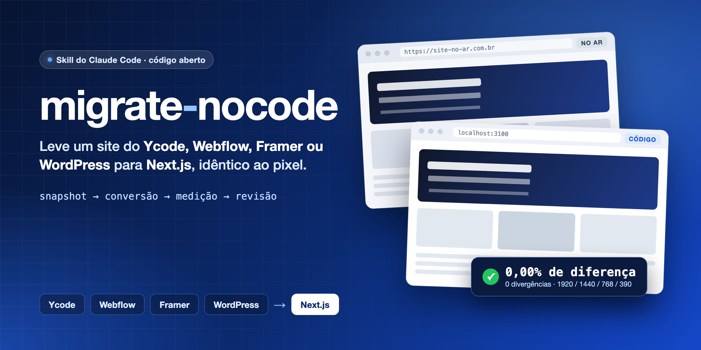
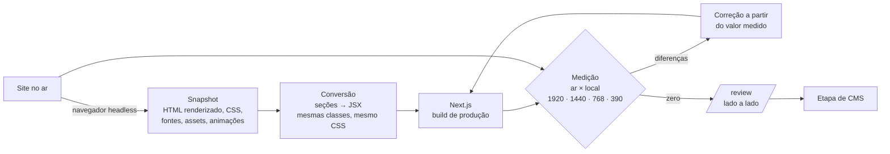

<p align="center">
  <a href="README.md">🇺🇸 English</a> &nbsp;·&nbsp; <b>🇧🇷 Português</b>
</p>

<p align="center">
  
</p>

<p align="center">
  <a href="#instalação"></a>
  <a href="#prompt-inicial"></a>
  <a href="README.md"></a>
</p>

<p align="center">
  
  
  
  
  
</p>

# migrate-nocode

**Um plugin do Claude Code que migra um site no ar feito em Ycode, Webflow, Framer ou WordPress para um projeto
Next.js idêntico ao site original, e prova isso com medição, página por página, em quatro larguras.**

A maioria das tentativas de "refazer esse site em código" termina *parecida*. O espaçamento escorrega, a fonte quebra a
linha em outro lugar, a animação fica estranha, o mobile é improvisado. Este plugin faz o contrário: trata o site no ar
como a especificação, converte o HTML que ele já entrega em vez de reinterpretar, e roda um ciclo de medição num
navegador invisível até a diferença entre o site no ar e o código novo ser **zero**.

Ele nasceu de migrações reais de clientes (um site bilíngue em Ycode com 107 rotas terminou com **424 medições e 0
propriedades divergentes**) e empacota tudo o que esses projetos ensinaram: as ferramentas, as armadilhas que custaram
horas, a página de revisão que os clientes adoraram e a etapa de CMS que vem depois.

---

## Sumário

- [Como funciona](#como-funciona)
- [O que vem dentro](#o-que-vem-dentro)
- [Instalação](#instalação)
- [Prompt inicial](#prompt-inicial)
- [O que acontece depois do Enter](#o-que-acontece-depois-do-enter)
- [Suporte por plataforma](#suporte-por-plataforma)
- [A página de revisão](#a-página-de-revisão)
- [A etapa de CMS](#a-etapa-de-cms)
- [Ferramentas](#ferramentas)
- [Critério de pronto](#critério-de-pronto)
- [Segurança](#segurança)
- [Perguntas frequentes](#perguntas-frequentes)
- [Contribuindo](#contribuindo)

---

## Como funciona



**O princípio: converter, não interpretar.** O site no ar já entrega um HTML com as classes e o CSS que produzem
exatamente o que o cliente aprovou. Então o plugin:

1. **Tira um snapshot** de cada rota num navegador de verdade (o DOM renderizado *e* o HTML bruto, porque os dados de
   animação ficam ali), espelha todos os assets num caminho local estável e registra a data, porque o site no ar muda
   durante a migração.
2. **Converte** cada seção em JSX mantendo todas as classes, todos os atributos `data-*` e `aria-*` e cada espaço não
   separável (sim, o `U+00A0` muda a quebra de linha).
3. **Mede** o ar contra o local no Chromium em 1920, 1440, 768 e 390 px: estilos computados de cada texto, imagem e
   controle (pareados pelo texto, descontando o deslocamento vertical), diferença de propriedades seção por seção,
   diferença de pixels da página inteira, altura do documento, rolagem horizontal, estados de interação e tempo das
   animações.
4. **Corrige** só a partir de valores medidos, nunca de "parece igual", até o relatório dar zero.
5. **Mostra** o resultado na página `/review`: todas as páginas, atual × novo, desktop e mobile, com os números.

A medição congela o tempo dos dois lados (relógio falso para GSAP, marquees e smooth scroll; animações CSS
congeladas), espera fontes e imagens carregarem *de verdade*, mascara blocos sorteados e GIFs e compara a cor
**renderizada**. Sem isso, diferença de pixel é só ruído.

> **Ele "usa a web"?** Não é pesquisa na internet. Ele controla um navegador invisível (Playwright/Chromium) apontado
> para o site que você está migrando: esse navegador é a referência. É só leitura: requisições GET, poucas por vez.

## O que vem dentro

Um plugin, sete skills que só carregam quando precisam:

| Skill | Quando carrega | O que traz |
|---|---|---|
| **`migrate`** | Você pede para migrar um site | Perguntas iniciais, o método fase a fase, as ferramentas, critério de pronto, relatório final |
| **`migrate-ycode`** | O site é Ycode | Conversão nativa em Tailwind, semântica do runtime do Ycode (interações GSAP, sliders Swiper), exportação do backup `.ycode` |
| **`migrate-webflow`** | O site é Webflow | `webflow.css` como base e depois Tailwind, extração das interações IX2, componentes `w-*`, CMS pela Data API v2 ou CSV |
| **`migrate-framer`** | O site é Framer | CSS do SSR como base e depois Tailwind, variantes de breakpoint, animações de entrada e de scroll com Motion, CMS por CSV |
| **`migrate-wordpress`** | O site é WordPress | Elementor, Divi, WPBakery, Gutenberg, plugins jQuery, conteúdo pela pasta, dump `.sql` ou REST: ACF, JetEngine, CPT UI, Yoast, Rank Math |
| **`migrate-content`** | Depois da etapa visual | Formato normalizado de conteúdo, validação, importação para Payload ou arquivos, redirects |
| **`migrate-review`** | No fim de cada lote | Gera e abre a página `/review` lado a lado |

E mais de 25 scripts Node (snapshot, assets, tojsx, measure, sections, states, motion, texts, intent-check,
verify-dom, head-check, run-all, build-review, exportadores por plataforma) que são **copiados para o seu projeto**,
então a migração fica reproduzível e commitada junto com o código.

## Instalação

**Requisitos:** [Claude Code](https://claude.com/claude-code) (terminal, app desktop ou extensão de IDE), Node.js 20+
e uns 2 GB livres para o Chromium e os assets espelhados.

### Opção 1: plugin do Claude Code (recomendado)

Dentro do Claude Code:

```text
/plugin marketplace add JefersonMarcioEspindola/skill-migrate-nocode
/plugin install migrate-nocode@migrate-nocode
```

Reinicie o Claude Code se ele pedir. As skills aparecem como `migrate-nocode:migrate`,
`migrate-nocode:migrate-webflow` etc. Para atualizar depois: `/plugin marketplace update migrate-nocode`.

### Opção 2: CLI de skills

```bash
npx skills add JefersonMarcioEspindola/skill-migrate-nocode
```

### Opção 3: manual

```bash
git clone https://github.com/JefersonMarcioEspindola/skill-migrate-nocode.git
mkdir -p ~/.claude/skills
cp -R skill-migrate-nocode/plugins/migrate-nocode/skills/* ~/.claude/skills/
```

Mantenha as sete pastas juntas: as skills de plataforma usam os scripts compartilhados da `migrate/`.

Na primeira execução ele instala o navegador sozinho (`npx playwright-core install chromium`).

## Prompt inicial

Abra o Claude Code numa **pasta vazia** (ou no repositório onde o site novo vai ficar) e cole:

```text
Use a skill migrate para migrar este site para Next.js, idêntico à versão no ar:

Site no ar: https://www.exemplo.com.br
Figma (opcional): <links ou "não tem">
Backup / exportação do CMS (opcional): <caminho do .ycode, CSV ou token da API do Webflow no .env.local, CSV do Framer, pasta do WordPress ou dump .sql, ou "ainda não tenho">
Idiomas: <ex.: só português / PT-BR + EN em /en>

Escopo agora: só o visual (layout, tipografia, imagens, motion, SEO, página de revisão). O conteúdo do CMS vem depois.
Faça suas perguntas iniciais numa mensagem só e depois trabalhe sozinho até fechar o quadro.
Não faça deploy nem push sem me perguntar.
```

Pronto. A skill `migrate` detecta a plataforma, pergunta o resto numa mensagem só (preferências de git, camada de
acabamento, senha da revisão…) e começa. Para retomar depois de um limite de uso: **"continue o quadro"**.

## O que acontece depois do Enter

| Fase | O que o agente faz | O que você recebe |
|---|---|---|
| 0. Preparação | Cria ou abre o projeto, copia as ferramentas, escreve o `migrate.config.json` | `tools/migrate/`, configuração |
| 1. Reconhecimento | Snapshot de todas as rotas, espelho dos assets, auditoria dos bugs do próprio site no ar, leitura da estrutura do CMS pelo backup ou dump (só inventário, sem conteúdo) | `snapshots/<data>/`, o quadro em `docs/layout-loop.md`, UMA lista de perguntas |
| 2. Fundações | Fontes, CSS base, breakpoints, variáveis de cor, imagens, bibliotecas do runtime | Home medida; divergências caem de dezenas para poucas |
| 3. Componentes compartilhados | Variantes do cabeçalho, menu mobile, rodapé, formulários | Medidos em 3 larguras e em todos os estados |
| 4. Páginas | Até 3 agentes de página em paralelo, cada um dono dos seus arquivos | Todas as páginas com 0 divergências |
| 5. Motion | Cada gatilho, tween, easing, stagger, breakpoint | Animações amostradas iguais nos dois lados |
| 5b. CSS → Tailwind | Só Webflow, Framer e WordPress: seção por seção, medido; um `legacy.css` pequeno e documentado para o que o Tailwind não expressa | Código em Tailwind v4, mesmos pixels |
| 6. Acabamento (opcional) | Contraste do header, hover de linha, marquee infinito, 404 da marca, bugs do ar corrigidos | Desvios registrados |
| 7. SEO | Head por rota, sitemap, hreflang, JSON-LD, redirects | `head-check` limpo |
| 8. Revisão | Página lado a lado | `/review` |
| 9. Verificação | Ressincronização com o ar, agentes verificadores independentes, revisão de código, checklist de publicação | Zero divergências medidas |
| 10. Relatório | Tabela página × largura, exceções, pendências por dono, checklist de deploy, mensagem para o cliente | Relatório + `/review` aberta |
| 11. CMS (depois) | Exporta, normaliza, valida e importa num banco de dev ou em arquivos | Conteúdo real e editável, mesmos pixels |

Tudo fica registrado no `docs/` do projeto (quadro, changelog, pendências por dono, decisões), então o trabalho
sobrevive a limite de uso, compactação de contexto e troca de pessoa.

## Suporte por plataforma

| | Ycode | Webflow | Framer | WordPress |
|---|---|---|---|---|
| CSS | Classes Tailwind v4 como estão | `webflow.css` como base → Tailwind | CSS do SSR como base → Tailwind | CSS do tema, do construtor e dos plugins como base → Tailwind |
| Ids estáveis para parear | `data-layer-id` | `data-w-id` + caminho no DOM | caminho no DOM | `data-id` do Elementor + caminho no DOM |
| Animações | JSON de interações do payload RSC → GSAP | JSON do IX2 no `webflow.js` → manter ou portar | Dados de appear + Motion amostrado | `data-settings`, Animate.css, AOS/WOW/GSAP |
| Fonte do CMS | Backup `.ycode` | Data API v2 ou CSV | Exportação CSV | Pasta, dump `.sql` ou REST · ACF · JetEngine · CPT UI |
| Testado em campo | ✅ migrações completas em produção | Ferramentas testadas em sites públicos | Ferramentas testadas em sites públicos | Ferramentas testadas em sites públicos |

O método não depende da plataforma: tudo o que um navegador renderiza dá para fotografar e medir. Wix, Squarespace ou
sites estáticos feitos à mão funcionam com a skill `migrate` e as regras gerais. Webflow, Framer e WordPress já tiveram
as ferramentas rodadas em sites públicos reais; ainda assim, a primeira migração em cada um vai ensinar alguma coisa à
skill. Issues e PRs são bem-vindos.

## A página de revisão

Cliente não lê relatório. Cliente olha imagem. A página `/review` coloca todas as páginas em sequência, uma linha para
cada, com quatro colunas: **Desktop atual · Desktop novo · Mobile atual · Mobile novo**. Embaixo de cada captura vão a
altura, o % de pixels diferentes e o número de divergências. Ela é `noindex`, bloqueada no robots, fora do sitemap e,
se quiser, protegida por senha (`REVIEW_PASSWORD`). A skill regenera a página a cada lote e **abre no fim de toda
migração**.

## A etapa de CMS

Primeiro o visual, depois o conteúdo. Na etapa visual, listas e posts viram JSON fixo extraído do snapshot,
renderizado por um template por coleção. Depois a skill `migrate-content`:

- exporta da plataforma (backup do Ycode, Data API v2 ou CSV do Webflow, CSV do Framer, pasta, dump `.sql` ou REST do
  WordPress);
- entende campos personalizados (grupos do ACF, repeaters e flexible content, meta boxes e relações do JetEngine, post
  types do CPT UI, SEO do Yoast e do Rank Math);
- escreve um **formato normalizado** (`content/<coleção>.json` + assets + redirects + relatório) e valida;
- importa com upserts idempotentes num banco de **desenvolvimento** ou em arquivos, nunca em produção;
- troca os mocks pelas consultas reais e mede de novo: a etapa de conteúdo não pode mexer em nenhum pixel.

## Ferramentas

| Script | Para quê |
|---|---|
| `detect.mjs <url>` | Descobre a plataforma, com as evidências |
| `snapshot.mjs` | HTML renderizado e bruto, fatos (head, CSS, fontes, assets, animações) por rota, com data |
| `assets.mjs [--verify]` | Espelha todos os assets num caminho local estável; baixa de novo o que o CDN trocou |
| `tojsx.mjs` | Lista as seções e converte em TSX (classes, data-*, aria-*, NBSP, srcset, next/link) |
| `measure.mjs` | Ar × local: estilos, pareamento por texto, deslocamento, altura, rolagem, pixels por faixa |
| `sections.mjs` | Seção por seção, ~45 propriedades computadas por elemento |
| `states.mjs` | Hover, foco, clique, sequências de passos, repouso × estado nos dois lados |
| `motion.mjs` | Opacity, transform e visibility amostrados ao longo do tempo no load e no scroll |
| `texts.mjs` | Todo texto visível, alt e meta: ar × local e snapshot × snapshot |
| `intent-check.mjs` | O que diff de pixel não vê: rolagem horizontal, texto atrás do header fixo, caixa cortada, `href="#"`, cursor, resize |
| `verify-dom.mjs` | DOM de cada rota de template × snapshot |
| `head-check.mjs` | `<head>` e status/redirect por rota |
| `run-all.mjs` | Tudo, todas as rotas × larguras, com resumo curto |
| `build-review.mjs` | A página `/review` (`--measure --open`, `--static`) |
| Exportadores | `ycode-export`, `webflow-cms-export`, `webflow-csv-import`, `framer-csv-import`, `wp-inventory`, `wp-export`, `content-validate` |

## Critério de pronto

Por página e largura, contra o build de produção: 0 divergências de elemento e 0 propriedades divergentes por seção;
altura do documento igual (ou exceção registrada); menos de ~0,3% de pixels diferentes (compressão de imagem, GIFs e
blocos sorteados são exceções declaradas); textos, head e DOM dos templates limpos; sem rolagem horizontal; hover, foco,
menu e animações medidos nos dois lados.

## Segurança

- **Só migre sites que são seus ou que você tem autorização para migrar.** O plugin lê páginas públicas, só leitura.
- Nunca lê, imprime ou commita `.env`, tokens de API, credenciais do `wp-config.php` ou segredos de backup.
- Nada de escrita em banco na etapa visual; a importação de conteúdo vai para um banco de dev, depois do seu ok.
- Nada de deploy, push ou `npm audit fix` sem o seu ok explícito.
- Nunca inventa conteúdo. Erros do site antigo são replicados e reportados para você decidir.

## Perguntas frequentes

**Quanto tempo leva?** Um site de 10 a 15 páginas com blog e cases: algumas horas de trabalho do agente na etapa
visual. Site grande gasta bastante limite de uso; a skill limita a 3 agentes em paralelo e salva checkpoints para você
retomar.

**Preciso de Figma?** Não. O site no ar é a fonte da verdade. O Figma ajuda nos valores de desktop, no favicon, na
imagem de compartilhamento e nos componentes que o cliente redesenhou e nunca publicou.

**Funciona em outros agentes (Cursor, Codex…)?** As skills são arquivos `SKILL.md` simples mais scripts Node; agentes que
suportam o formato de skills podem usar. Foi feito e testado no Claude Code.

**O código sai "limpo"?** Sai *fiel* primeiro: componentizado por seção, com as classes da plataforma (o Ycode já é Tailwind) ou o CSS
dela como base medida. No Webflow, Framer e WordPress, depois ele é convertido para Tailwind seção por seção, medido de
novo a cada passo, com um `legacy.css` pequeno e documentado para o que o Tailwind não expressa. Refatorar para um
design system é um passo separado e deliberado: fazer isso antes de existir uma base medida é justamente o que faz o
site escorregar.

**E formulários, loja, área de membros?** Formulários são migrados no visual (todos os estados) e ligados a um backend
na etapa de conteúdo. Loja e área de membros ficam fora do escopo e entram nas pendências.

## Contribuindo

Issues e PRs são bem-vindos, principalmente conhecimento de plataforma (um construtor novo, um formato de animação, um
caminho de exportação de CMS) e correções nas ferramentas. Se migrar um site com ele, abra uma issue contando onde a
skill errou: foi assim que a lista de armadilhas cresceu.

## Licença

[MIT](LICENSE) © Jeferson Marcio Espindola
